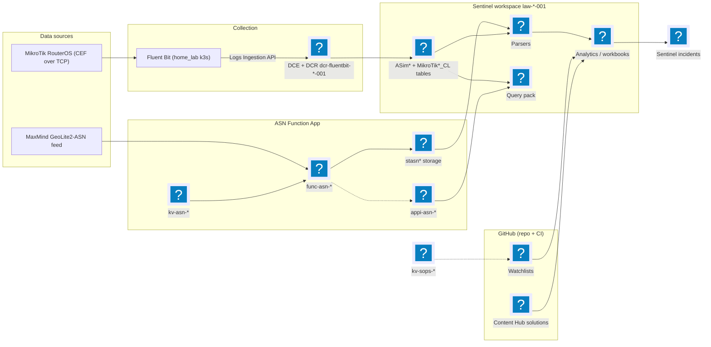

# Azure Sentinel Setup in Terraform

Deployment for Azure Sentinel via Terraform

Well for now it is just a LAW, the plan is to upgrade to Sentinel

## Required permissions

### CI service principal (GitHub Actions, OIDC)

Azure RBAC on the target subscription / resource groups:

- **Contributor** on `rg-log-neu-01` — create the workspace, DCRs, function app,
  storage, Key Vaults, Logic App, automation rules, etc.
- **Role-assignment write** (e.g. *Role Based Access Control Administrator* or
  *User Access Administrator*) for this repo's `azurerm_role_assignment`
  resources. If that permission is ABAC-conditioned, the condition must allow the
  roles assigned here — including **Microsoft Sentinel Automation Contributor**
  and **Microsoft Sentinel Responder**.
- **Storage Blob Data Contributor** on the Terraform state storage account.

Microsoft Graph **application** permissions, admin-consented on the CI app
registration in Entra:

- **`CustomDetection.ReadWrite.All`** — deploy/manage Defender XDR custom
  detection rules (`detection_rules.tf`).
- **`ThreatHunting.Read.All`** — run advanced hunting queries (detection-rule
  testing).

> These Graph permissions can't be bootstrapped from Terraform — the CI
> principal can't read or modify app registrations — so grant and
> **admin-consent them in the Entra portal**.

### Microsoft Sentinel

- The **Azure Security Insights** first-party service principal needs
  **Microsoft Sentinel Automation Contributor** on `rg-log-neu-01` so automation
  rules can run the Discord notification playbook (*Microsoft Sentinel →
  Settings → Manage playbook permissions*).

## Architecture

> Uses Mermaid flowchart *icon* node shapes with iconify icons. GitHub's
> built-in Mermaid renderer does **not** load external icon packs, so the icons
> only appear in environments that register them (e.g. mermaid.live, or docs
> sites with `mermaid.registerIconPacks([...])` for `@iconify-json/logos`).




### Custom tables

Use the script `createLogDeclaration.sh` to generate a table declaration for a custom log.

Example use:

```sh
./createLogDeclaration.sh "TimeGenerated, Computer, Message"
```

Output:

```json
[
    {
        "name": "TimeGenerated",
        "type": "enter_type",
        "desription": "enter_description"
    },
    {
        "name": "Computer",
        "type": "enter_type",
        "desription": "enter_description"
    },
    {
        "name": "Message",
        "type": "enter_type",
        "desription": "enter_description"
    }
]
```

### Sentinel codeless connectors (CCF)

Codeless connectors are deployed directly with the `azapi` provider via the
`IaC/modules/codeless_connector` module (data connector definition + RestApiPoller
connections) — no ARM solution template or Content Hub install step. The DCR, DCE
and output tables they bind to are created by their own modules and passed in.

When authoring a connector definition or poller, the **Microsoft Sentinel RM REST
API** is the authoritative reference for the resource body and exactly which fields
are required — the prose CCF docs and the REST API model sometimes disagree, so
trust the REST API:

- Operation groups: <https://learn.microsoft.com/rest/api/securityinsights/operation-groups>
- Data connectors (RestApiPoller): <https://learn.microsoft.com/rest/api/securityinsights/data-connectors/create-or-update>

### Log collection (MikroTik → Fluent Bit → Sentinel)

The MikroTik router (configured in the `home_net` repo) sends its logs as **CEF
over TCP** to **Fluent Bit** in the `home_lab` cluster (`apps/fluent-bit`,
`kube-01:514`). Fluent Bit buffers every event on disk and sends it with the
**Logs Ingestion API** to `dce-fluentbit-*-001` / `dcr-fluentbit-*-001`
(`IaC/log_dce.tf`, `IaC/log_dcr_fluent_bit.tf`).

- `dcr-fluentbit-*-001` is generic: each log source gets its own input stream
  (`Custom-<Name>`, = Fluent Bit's output `table_name`) and data flows. MikroTik
  uses `Custom-MikroTikSyslog` (`TimeGenerated`, `HostName`, `HostIP`, `SyslogMessage`).
- The MikroTik transforms (`IaC/log_dcr_mikrotik.tf`) accept both RouterOS
  formats — CEF is rewritten to `<topics> <message>` first — and write to
  `ASimNetworkSessionLogs`, `ASimDhcpEventLogs`, `MikroTikSystem_CL` and
  `MikroTikDns_CL`.
- RouterOS never logs a firewall rule's action, so `home_net` prefixes each rule's
  log prefix with a letter (`A`ccept, `D`rop, `R`eject, `L`og) that the DCR maps to
  `DvcAction`.
- Fluent Bit authenticates as the `fluent-bit-home-lab` service principal
  (created in `azure-init`, **Monitoring Metrics Publisher** on the DCR); its
  credentials are a sops-encrypted Secret in `home_lab`.

### TODO

- ~~Change to a Sentinel workspace~~
- Create some KQL queries
- ~~Fix a Go program for logging and create a linux service for it~~ (replaced by Fluent Bit in home_lab)
- Fix a pipeline for deployment
- Move DCR to separate file, and try to make it less anoying to work with
- Validate detection rule queries in `test-detection-rules.yaml` against the advanced hunting schema via Graph beta `GET /security/getHuntingSchema` (tables/columns exist)
